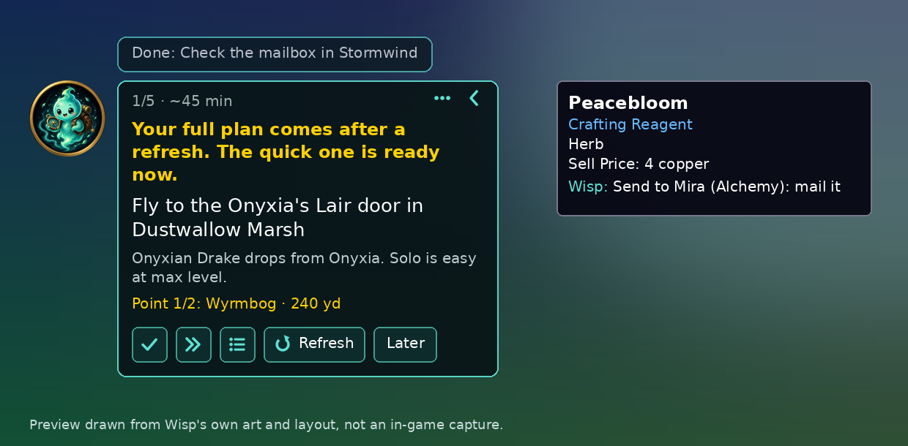

# Unbored

**Bored in World of Warcraft? Wisp tells you what to do next.**

Unbored puts Wisp, a small glowing spirit, on your screen. Tell her your mood and how much time you have, and she gives you one step at a time, with a map pin. She also answers questions about the world and tells you what to do with the items in your bags.

[По-русски ниже](#по-русски)

A preview drawn from Wisp's own art and layout. In-game screenshots are coming.

## Install

1. Download the **Unbored Companion** installer for Windows: open the [newest Companion release](https://github.com/hmbanan666/wow-unbored/releases?q=companion&expanded=true) and click the file ending in `-setup.exe`.
2. Run it. Windows may warn you because the installer isn't signed yet: click **More info**, then **Run anyway**. The Companion finds World of Warcraft and puts Wisp into the game.
3. Start the game (Retail) and click Wisp on the left of your screen.

The Companion keeps itself and Wisp up to date. Your PC needs a one-time OK from the Unbored team before fuller answers start; Wisp's quick plans and tips work right away.

No Windows, or prefer doing it by hand? Download `Unbored-v….zip` from the newest [addon release](https://github.com/hmbanan666/wow-unbored/releases), unzip it into `World of Warcraft/_retail_/Interface/AddOns/`, and start the game.

## What Wisp can do

- **Plans for your mood.** One click: stay nearby, get a mount, collect pets and toys, level up, farm gold, or surprise me. A quick plan starts at once, one step at a time, with a pin on the map. A fuller plan follows from the Companion.
- **Answers.** Ask "what can I do here?", "any rares around?", or anything else, in English or Russian. Common questions get an answer right away; bigger ones get a fuller answer a little later.
- **Item tips.** Every item tooltip gets one short line from Wisp: junk to sell, a new mount or toy to learn, a quest to turn in, an upgrade, or "send it to your alchemist alt".
- **What is this item?** Drop any item on Wisp and she tells you what she knows.
- **Stays out of the way.** She hides in combat, folds down to a small portrait, and has a minimap button. No slash commands needed.

## FAQ

**Is it allowed by Blizzard?**
Yes, it follows the same rules as every other addon. Wisp only suggests things; she never plays for you and never presses anything on her own. The Companion works like the Raider.IO or WeakAuras companion apps: it only reads and writes addon files in your World of Warcraft folder. It does not read game memory, inject anything, or touch `Wow.exe`. Unbored is a fan project and is not made by Blizzard.

**Why does Wisp sometimes offer a Refresh?**
The game reads addon files only when your interface loads: at login, when you switch characters, or when you reload. Teleports and loading screens don't count. When the Companion has something new (a fuller plan or answer), Wisp asks once: "New stuff is ready. Refresh now?" Refresh reloads your interface for a few seconds. Later is fine too: it will be there at your next login. Wisp never reloads by herself.

**What data does it use?**
The addon itself never goes online. The Companion sends your questions and your character's state (where you are, level, class, item level, gold, bags and bank, professions, collections, recent steps) to the Unbored server, so the planner can give answers that fit you and your other characters. It is stored per character, linked to your game account, and used only for Unbored. No passwords, no Battle.net login, no chat logs.

**Does it work without the Companion?**
Yes: quick plans, item tips and answers to common questions all work in the game alone. Fuller answers and full plans need the Companion.

**Something looks wrong?**
[Open an issue](https://github.com/hmbanan666/wow-unbored/issues). Wisp keeps a short error list for that: type `/unbored errors` in chat.

## По-русски

**Скучно в World of Warcraft? Висп подскажет, чем заняться.**

Unbored добавляет на экран Виспа — маленького светящегося духа. Скажи, какое настроение и сколько есть времени, и он даст по одному шагу за раз, с меткой на карте. А ещё ответит на вопросы о мире и подскажет, что делать с предметами в сумках.

### Установка

1. Скачай установщик **Unbored Companion** для Windows: открой [последний релиз Companion](https://github.com/hmbanan666/wow-unbored/releases?q=companion&expanded=true) и нажми на файл, который заканчивается на `-setup.exe`.
2. Запусти его. Windows может предупредить, что установщик пока не подписан: нажми **Подробнее**, затем **Выполнить в любом случае**. Companion сам найдёт World of Warcraft и добавит Виспа в игру.
3. Запусти игру (Retail) и нажми на Виспа слева на экране.

Companion сам обновляет себя и Виспа. Чтобы заработали полные ответы, ПК нужно один раз одобрить со стороны Unbored; быстрые планы и подсказки работают сразу.

Нет Windows или хочешь вручную? Скачай `Unbored-v….zip` из последнего [релиза аддона](https://github.com/hmbanan666/wow-unbored/releases), распакуй в `World of Warcraft/_retail_/Interface/AddOns/` и запусти игру.

### Что умеет Висп

- **Планы под настроение.** Один клик: заняться чем-то рядом, добыть маунта, собрать питомцев и игрушки, качаться, фармить золото или «удиви меня». Быстрый план начинается сразу, по шагу за раз, с меткой на карте. Полный план приходит от Companion.
- **Ответы.** Спроси «чем заняться рядом?», «есть рядом редкие?» или что угодно ещё, по-русски или по-английски. На частые вопросы ответ сразу, на сложные — полный ответ чуть позже.
- **Подсказки к предметам.** В подсказке каждого предмета одна короткая строка от Виспа: хлам на продажу, новый маунт или игрушка, квест сдать, улучшение или «отправь своему алхимику».
- **Что это за предмет?** Брось любой предмет на Виспа, и он расскажет, что знает.
- **Не мешает.** Прячется в бою, сворачивается в маленький портрет, есть кнопка у миникарты. Команды в чате не нужны.

### Вопросы

**Это разрешено Blizzard?**
Да, Unbored следует тем же правилам, что и любой аддон. Висп только подсказывает: он не играет за тебя и ничего не нажимает сам. Companion работает как приложения Raider.IO или WeakAuras: читает и пишет только файлы аддонов в папке игры. Он не читает память игры, ничего не внедряет и не трогает `Wow.exe`. Unbored — фанатский проект, Blizzard его не делала.

**Почему Висп иногда предлагает «Обновить»?**
Игра читает файлы аддонов только при загрузке интерфейса: при входе, смене персонажа или перезагрузке. Телепорты и экраны загрузки не считаются. Когда у Companion появляется новое (полный план или ответ), Висп один раз спросит: «Есть кое-что новое. Обновить сейчас?» «Обновить» перезагрузит интерфейс на пару секунд. «Потом» — тоже нормально: всё будет при следующем входе. Сам Висп никогда ничего не перезагружает.

**Какие данные используются?**
Сам аддон в интернет не ходит. Companion отправляет на сервер Unbored твои вопросы и состояние персонажа (где ты, уровень, класс, уровень предметов, золото, сумки и банк, профессии, коллекции, недавние шаги), чтобы ответы подходили тебе и твоим другим персонажам. Данные хранятся по персонажам, связаны с игровой учётной записью и используются только для Unbored. Никаких паролей, входа в Battle.net и логов чата.

**Работает без Companion?**
Да: быстрые планы, подсказки к предметам и ответы на частые вопросы работают в самой игре. Для полных ответов и полных планов нужен Companion.

**Что-то не так?**
[Напиши нам](https://github.com/hmbanan666/wow-unbored/issues). Висп хранит короткий список ошибок: набери `/unbored errors` в чате.

---

Building, data tables, the plan format and releases: [docs/DEVELOPMENT.md](docs/DEVELOPMENT.md). License: [MIT](LICENSE).
