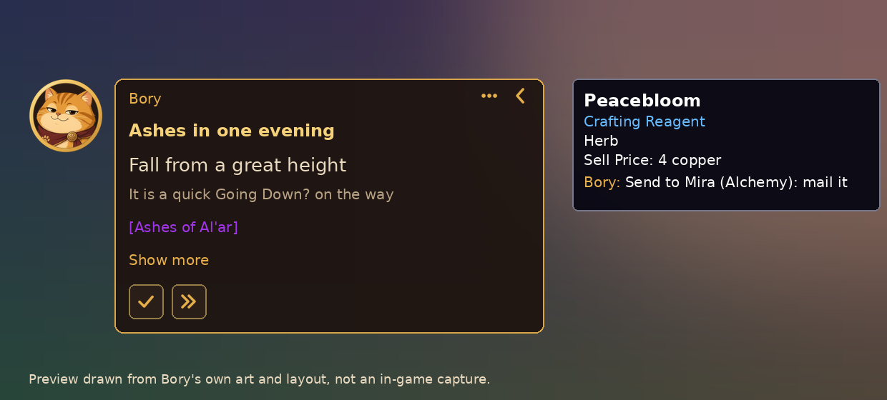

# Unbored

**Bored? Bory's got a plan.**

Unbored for World of Warcraft puts Bory, a calm ginger cat, on your screen. Tell him your mood, and he gives you one step at a time, with a map pin. He also answers questions about the world around you and tips you off about items that matter to you.

[По-русски ниже](#по-русски)

A preview drawn from Bory's own art and layout. In-game screenshots are coming.

## Install

1. Download the **Unbored Companion** installer for Windows: open the [newest release](https://github.com/hmbanan666/wow-unbored/releases/latest) and click the file ending in `-setup.exe`.
2. Run it. Windows may warn you because the installer isn't signed yet: click **More info**, then **Run anyway**. The Companion finds World of Warcraft and puts Bory into the game.
3. Start the game (Retail) and click Bory on the left of your screen.

The Companion keeps itself and Bory up to date. Your PC needs a one-time OK from the Unbored team before fuller answers start; Bory's quick plans and tips work right away.

No Windows, or prefer doing it by hand? Download `Unbored-v….zip` from the newest [addon release](https://github.com/hmbanan666/wow-unbored/releases), unzip it into `World of Warcraft/_retail_/Interface/AddOns/`, and start the game.

## What Bory can do

- **Plans for your mood.** One click: stay nearby, get a mount, collect pets and toys, level up, farm gold, or surprise me. A quick plan starts at once, one step at a time, with a pin on the map. Want a proper plan? Answer one short question, send it, and Bory shows he's working on it until it's ready. Proper plans cover the whole goal, not just what fits in half an hour.
- **Links in steps.** Items, quests, achievements, spells and currencies in a step are real game links: hover for the tooltip. Click a place or an NPC to set the map pin.
- **Answers.** Ask "what can I do here?", "any rares around?", or "what's left for my achievements?", in English or Russian. Anything bigger he offers to turn into a plan.
- **Item tips, only when it's about you.** A short line in the tooltip only when the item is in your plan, new for your collection, starts a quest you haven't done, or should go to one of your alts ("Send to Mira (Alchemy 75): mail it"). Otherwise he stays quiet. You can turn the lines off in Bory's settings.
- **What is this item?** Drop any item on Bory and he tells you what he knows.
- **Stays out of the way.** He hides in combat, folds down to a small portrait, and has a minimap button. No slash commands needed.

## What Bory knows about you

Bory learns about **your own characters only**, so plans fit what you have and what you have left to do.

- **What he reads:** level, class, spec and talents, item level, gold, gear, bags, your bank and warband bank (when you open them), currencies, professions and recipes (when you open the profession window), completed and active quests, reputations and renown, achievements, mounts, pets, toys, appearance counts, raid and dungeon lockouts, Mythic+ score and keystone, Great Vault progress, holidays from the calendar, time played, where you spent your sessions, and which helper addons you use (TomTom, Auctionator and the like).
- **When:** the addon reads quietly after you log in and when something changes, never in combat. The game saves it to your addon files when you log out, switch characters or reload. The Companion then sends what changed to the Unbored server. The addon itself never goes online.
- **What he never reads:** anything about other players. No chat or whispers, no mail senders, subjects or text, no group or guild lists, no other players' names, no combat log. No passwords and no Battle.net sign-in.
- **What it's for:** your plans and tips, and the tips for your other characters (an alt you played on another PC can still get your reagents). It is kept per character, linked to your game account, and used only for Unbored.
- **Turn it off:** right-click Bory, **Settings**, untick **Share game data to make Bory smarter**. Bory then keeps only what a plan needs: your character, gear, quest log and recent sessions.

## FAQ

**Is it allowed by Blizzard?**
Yes, it follows the same rules as every other addon. Bory only suggests things; he never plays for you and never presses anything on his own. The Companion works like the Raider.IO or WeakAuras companion apps: it only reads and writes addon files in your World of Warcraft folder. It does not read game memory, inject anything, or touch `Wow.exe`. Unbored is a fan project and is not made by Blizzard.

**Why does Bory sometimes offer a Refresh?**
The game reads addon files only when your interface loads: when you log in, switch characters, or reload. Teleports and loading screens don't count. When the Companion has something new (a fuller plan or answer), Bory asks once: "New stuff is ready. Refresh now?" Refresh reloads your interface for a few seconds. Later is fine too: it will be there next time you log in. Bory never reloads by himself.

**What data does it use?**
Only your own characters. See [What Bory knows about you](#what-bory-knows-about-you).

**Does it work without the Companion?**
Yes: quick plans, item tips and answers all work in the game alone. Proper plans need the Companion.

**Something looks wrong?**
[Open an issue](https://github.com/hmbanan666/wow-unbored/issues). Bory keeps a short error list for that: type `/unbored errors` in chat.

## По-русски

**Скучно? У Бори есть план.**

Unbored для World of Warcraft добавляет на экран Бори — спокойного рыжего кота. Скажи, какое настроение, и он даст по одному шагу за раз, с меткой на карте. А ещё ответит на вопросы о мире вокруг и подскажет про предметы, которые важны именно тебе.

### Установка

1. Скачай установщик **Unbored Companion** для Windows: открой [последний релиз](https://github.com/hmbanan666/wow-unbored/releases/latest) и нажми на файл, который заканчивается на `-setup.exe`.
2. Запусти его. Windows может предупредить, что установщик пока не подписан: нажми **Подробнее**, затем **Выполнить в любом случае**. Companion сам найдёт World of Warcraft и добавит Бори в игру.
3. Запусти игру (Retail) и нажми на Бори слева на экране.

Companion сам обновляет себя и Бори. Чтобы заработали полные ответы, ПК нужно один раз одобрить со стороны Unbored; быстрые планы и подсказки работают сразу.

Нет Windows или хочешь вручную? Скачай `Unbored-v….zip` из последнего [релиза аддона](https://github.com/hmbanan666/wow-unbored/releases), распакуй в `World of Warcraft/_retail_/Interface/AddOns/` и запусти игру.

### Что умеет Бори

- **Планы под настроение.** Один клик: заняться чем-то рядом, добыть маунта, собрать питомцев и игрушки, качаться, фармить золото или «удиви меня». Быстрый план начинается сразу, по шагу за раз, с меткой на карте. Нужен настоящий план? Ответь на один короткий вопрос, отправь, и Бори покажет, что думает, пока план не будет готов. Настоящий план охватывает всю цель, а не то, что влезет в полчаса.
- **Ссылки в шагах.** Предметы, квесты, достижения, заклинания и валюты в шаге — настоящие игровые ссылки: наведи, чтобы увидеть подсказку. Нажми на место или NPC, чтобы поставить метку на карте.
- **Ответы.** Спроси «чем заняться рядом?», «есть рядом редкие?» или «что осталось по достижениям?», по-русски или по-английски. Если вопрос большой, Бори предложит сделать из него план.
- **Подсказки к предметам — только про тебя.** Короткая строка в подсказке, только если предмет нужен для твоего плана, новый для коллекции, начинает квест, который ты ещё не делал, или пригодится твоему альту («Отправь Мире (алхимия 75): почтой»). В остальных случаях Бори молчит. Строки можно выключить в настройках Бори.
- **Что это за предмет?** Брось любой предмет на Бори, и он расскажет, что знает.
- **Не мешает.** Прячется в бою, сворачивается в маленький портрет, есть кнопка у миникарты. Команды в чате не нужны.

### Что Бори знает о тебе

Бори узнаёт **только о твоих персонажах**, чтобы планы подходили к тому, что у тебя есть и что осталось сделать.

- **Что он читает:** уровень, класс, специализацию и таланты, уровень предметов, золото, экипировку, сумки, твой банк и банк отряда (когда ты их открываешь), валюты, профессии и рецепты (когда открываешь окно профессии), выполненные и текущие квесты, репутации и известность, достижения, маунтов, питомцев, игрушки, число собранных обликов, сохранения рейдов и подземелий, рейтинг М+ и ключ, прогресс Великого хранилища, праздники из календаря, время в игре, где проходили твои сессии и какие аддоны-помощники стоят (TomTom, Auctionator и подобные).
- **Когда:** аддон тихо читает после входа в игру и когда что-то меняется, никогда в бою. Игра сохраняет это в файлы аддона при выходе, смене персонажа или перезагрузке. Потом Companion отправляет изменения на сервер Unbored. Сам аддон в интернет не ходит.
- **Что он никогда не читает:** ничего о других игроках. Ни чата и шёпота, ни отправителей, тем и текста писем, ни списков группы или гильдии, ни имён других игроков, ни журнала боя. Никаких паролей и входа в Battle.net.
- **Зачем:** для твоих планов и подсказок, в том числе для других персонажей (альт, которым ты играл на другом ПК, всё равно получит твои реагенты). Данные хранятся по персонажам, связаны с игровой учётной записью и используются только для Unbored.
- **Как выключить:** правый клик по Бори, **Настройки**, сними галочку **Делиться игровыми данными, чтобы Бори был умнее**. Тогда Бори хранит только то, что нужно для плана: персонажа, экипировку, журнал заданий и недавние сессии.

### Вопросы

**Это разрешено Blizzard?**
Да, Unbored следует тем же правилам, что и любой аддон. Бори только подсказывает: он не играет за тебя и ничего не нажимает сам. Companion работает как приложения Raider.IO или WeakAuras: читает и пишет только файлы аддонов в папке игры. Он не читает память игры, ничего не внедряет и не трогает `Wow.exe`. Unbored — фанатский проект, Blizzard его не делала.

**Почему Бори иногда предлагает «Обновить»?**
Игра читает файлы аддонов только при загрузке интерфейса: при входе, смене персонажа или перезагрузке. Телепорты и экраны загрузки не считаются. Когда у Companion появляется новое (полный план или ответ), Бори один раз спросит: «Есть кое-что новое. Обновить сейчас?» «Обновить» перезагрузит интерфейс на пару секунд. «Потом» — тоже нормально: всё будет при следующем входе. Сам Бори никогда ничего не перезагружает.

**Какие данные используются?**
Только твоих персонажей. Подробно — в разделе [Что Бори знает о тебе](#что-бори-знает-о-тебе).

**Работает без Companion?**
Да: быстрые планы, подсказки к предметам и ответы работают в самой игре. Для настоящих планов нужен Companion.

**Что-то не так?**
[Напиши нам](https://github.com/hmbanan666/wow-unbored/issues). Бори хранит короткий список ошибок: набери `/unbored errors` в чате.

---

Building, data tables, the plan format and releases: [docs/DEVELOPMENT.md](docs/DEVELOPMENT.md). Names, mascot and look: [BRAND.md](BRAND.md). License: [MIT](LICENSE).
